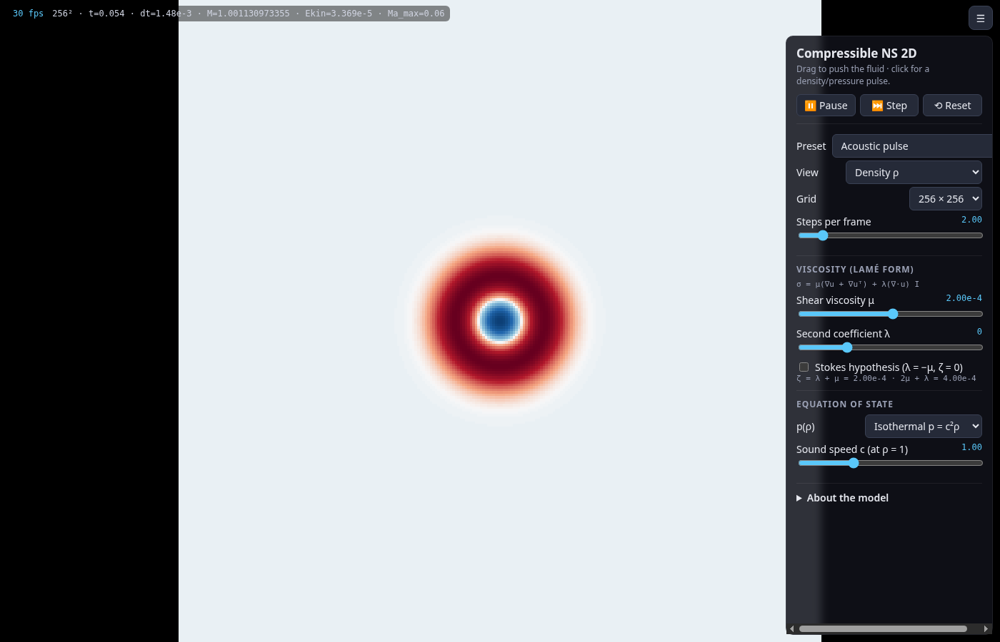

# Compressible-velocity active fluid 2D

**Live demo: https://csviragh.github.io/compressible-ns-sim/**

Interactive 2D active fluid with a *compressible* velocity field (no pressure projection) and a
Lamé viscous operator (shear viscosity μ, second coefficient λ), plus the self-propulsion term of its
sister project [navier-stokes-sim](https://github.com/csviragh/navier-stokes-sim) (incompressible).
Vite + TypeScript, plain canvas, no runtime dependencies.



## Equations

A Stable-Fluids-style solver like navier-stokes-sim, but **without the pressure projection and
without any equation of state**: the velocity is free to compress (∇·u ≠ 0). On the periodic unit
square (default 256 × 256, side 1, unit density):

```
∂u/∂t + (u·∇)u = χ_L [μ∇²u + (λ+μ)∇(∇·u)] + f_rep − (1/τ)(|u| − v₀) u/|u| + f
```

χ_L ∈ {0, 1} is the **Lamé switch** (UI checkbox "Enable Lamé viscous term"; off drops μ and λ together),
and f_rep is a **retarded pairwise repulsion** (below). Neither term adds a pressure projection, so the
velocity stays compressible. There are no global/uniform delays any more: the only retardation is the
distance-dependent one of the repulsion.

### Pairwise repulsion with retarded potential

Each grid cell is a fluid element of mass ρh². The source cell y pushes cell x away with

```
f_rep(x, t) = A Σ_{y ≠ x, |x−y| < R₀} ρ(y, t − |x−y|/v_int) · K(|x−y|) · (x − y)/|x − y| · h²
```

(acceleration of x; i.e. pair force ∝ ρ(x)ρ(y), divided by the mass of x). Periodic minimum-image
offsets; uniform ρ gives zero net force.

**Kernel K(d)** (range R₀, exponent α):

```
K(d) = [(R₀/d)^α − 1] · (1 − d/R₀)²     0 < d < R₀,     K(d) = 0 otherwise (own cell d = 0 excluded)
```

* K → ∞ as d → 0 (divergent, short-range-dominated repulsion), monotonically decreasing;
* K(R₀) = 0 and K′(R₀) = 0: the force switches off smoothly at the range;
* α ∈ [0.1, 1.95] (slider, default 1). α = 0 gives K ≡ 0, so the minimum is 0.1 (also enforced in code).
* **In 2D the continuum force integral ∫ K(d) d dd (area element 2πd dd) converges only for α < 2.**
  For α ≥ 2 it diverges at d → 0, the sum is dominated by the nearest grid cells and the results become
  grid-dependent (they change with h); hence the slider stops at 1.95. Even for α < 2 close to 2 the
  nearest-neighbour cells carry most of the weight.

**Retardation:** the interaction propagates at v_int, so the source density is read at
t − d/v_int (Eulerian, at the fixed source cell) from a ring buffer of past ρ fields (`FieldHistory`,
one frame per Δt, linear interpolation in time, current ρ = newest point). v_int = ∞ (slider at the right
end) is instantaneous and keeps no history. Only the repulsion is retarded; Lamé, advection,
self-propulsion and density transport use the present state.

UI: enable, strength A, R₀, α, v_int (log slider, rightmost = ∞).
Cost is O(N·(R₀/h)²) per step (direct sum, about 300 offsets at the defaults on 256²).

### Order parameter / correlations

Same panel as navier-stokes-sim: histogram of P(cos θ_ij) over pairs of cell directions (30 000 sampled pairs), exact ⟨cos θ_ij⟩ = (|Σv̂|² − N)/(N(N−1)), radial correlation C(r) (full and connected) with correlation length ξ (first zero of C_conn), and a 20 s time trace of ⟨cos θ⟩, φ and ξ.

### Density-weighted order parameters

Since the velocity is compressible, cells hold different amounts of fluid. Next to the unweighted
quantities, the HUD shows density-weighted ones (computed on the CPU from the current fields, so they
are identical for the CPU and the WebGPU backend, whose fields are read back each frame):

```
Φ   = |Σ_i û_i| / N'                 Φ_ρ     = |Σ_i ρ_i û_i| / Σ_i ρ_i         (û = u/|u|)
⟨|u|⟩ = Σ_i |u_i| / N                ⟨|u|⟩_ρ = Σ_i ρ_i |u_i| / Σ_i ρ_i
```

Cells with |u_i| ≤ 1e-12 have no direction and are left out of both sums of Φ and Φ_ρ (N' = number of
remaining cells), so for uniform ρ, Φ_ρ = Φ exactly; zero-density cells contribute nothing; a weight sum
of 0 gives 0. The correlation panel adds the pair-weighted (w_ij = ρ_iρ_j, i ≠ j) mean
⟨cos θ_ij⟩_ρ = (|Σρv̂|² − Σρ²)/((Σρ)² − Σρ²), φ_dir,ρ, and a ρ-weighted P(cos θ_ij) (green outline over the
unweighted bars, same sampled pairs). C(r) and ξ stay unweighted.

### Passive density

A density field ρ (initially 1, reset by the init buttons) is carried by the continuity equation
`∂ρ/∂t + ∇·(ρu) = 0` with **no feedback on u** (no pressure, no EOS). Finite volume in flux form:
MUSCL reconstruction (MC limiter) with upwind face fluxes, face velocity = mean of the two cells,
SSP-RK2 sub-steps at per-direction CFL ≤ 0.25. Total mass is conserved to round-off; a ρ ≥ 0
floor is a last-resort safeguard, and the HUD reports it if it ever fires.

### Lamé convention

The viscous term is the Navier–Lamé operator ∇·σ with

```
σ = μ(∇u + ∇uᵀ) + λ(∇·u) I     ⇒   ∇·σ = μ∇²u + (λ+μ)∇(∇·u)
```

μ is the shear viscosity and λ the second (Lamé) coefficient. Per Fourier mode the operator is
−μk²û − (λ+μ)k(k·û), so

* transverse (shear, k ⊥ û) modes decay at **μk²**,
* longitudinal (compressive, k ∥ û) modes decay at **(λ + 2μ)k²**.

Well-posedness (ellipticity) needs μ ≥ 0 and **λ + 2μ ≥ 0**; the solver clamps λ to −2μ and the
UI warns. For reference the panel also shows the 2D bulk viscosity ζ = λ + μ (σ = 2μ·dev D + ζ(∇·u)I).

### Self-propulsion

Identical to navier-stokes-sim: −(1/τ)(|u| − v₀) u/|u|, integrated exactly per step,
|u| → v₀ + (|u| − v₀)e^{−Δt/τ} along u/|u| (defaults τ = 0.5 s, v₀ = 0.5).

## Numerics

Operator splitting per step (Δt = 1/60 s):

1. forces (mouse drag);
2. retarded repulsion kick u += Δt·f_rep (computed from ρ at the start of the step and its history);
3. **Lamé step (if enabled), explicit forward Euler**, sub-stepped: ns = ceil(Δt·Λ/1.8) with the Gershgorin
   bound Λ = (8μ + 5|λ+μ|)/h² of the spectrum of −L, so Δt_sub·Λ ≤ 1.8 < 2 (forward-Euler limit for the
   undelayed operator; e.g. μ = 1e-4, λ = 0, 256²: Λ ≈ 85 /s, Δt_sub ≤ 0.024 s, 1 sub-step at Δt = 1/60).
   Conserves the mean momentum.
4. continuity step for ρ;
5. **semi-Lagrangian advection** of u and the dye (midpoint back-trace, bilinear, periodic);
6. exact self-propulsion relaxation.

There is no pressure solve, so compression waves are not sound waves: a compressive mode only
decays at (λ+2μ)k² and is carried/steepened by advection.

## WebGPU backend

`src/gpu/` ports the whole step to WGSL compute shaders (`shaders.wgsl`, host code `gpuSolver.ts`):
forces + retarded repulsion (`repulse`), the Lamé sub-steps with the on/off switch (`lame`), the
density CFL reduction (`umax`, atomic max), the MUSCL/SSP-RK2 continuity sub-steps (`dens1–3`, written
as a gather instead of the CPU's flux scatter) and semi-Lagrangian advection fused with self-propulsion
and dye fade (`advect`). The ρ history for the retarded repulsion lives in a GPU ring buffer; its
bookkeeping (frame times, interval, pruning, interpolation weights) reuses `FieldHistory` on the CPU,
so the delay lookups are the same as in the CPU code. GPU arithmetic is f32 (CPU f64).

* `navigator.gpu` is auto-detected; without it (or on any GPU error) the CPU code is used.
  The **Backend** selector switches at any time (switching restarts the ρ history); `?backend=cpu` forces CPU.
* After each frame u, v, ρ, dye are read back into the CPU arrays, so rendering, arrows, HUD and
  correlations are unchanged (rendering itself is still on the CPU).
* Density sub-steps per step are capped on the GPU at min(64, 2·n_est + 2) from the previous frame's
  max |u|; if the GPU needs more, the info line warns.
* Dev check: `?gpucheck=10` compares 10 steps GPU vs CPU from the same state and prints the relative max
  differences; `npm run gpucheck` does it headlessly for several parameter sets (needs Chrome).
  With SwiftShader, 40 steps on 256² agree to ~1e-5 relative (≤1e-3 with the Lamé term off).

## Controls

* **Drag**: push the fluid and inject dye.
* **🎲 Random initial conditions**, **➡ Ordered + perturbation** (uniform flock along +x at v₀ with a
  small disordered swirl patch, σ = 0.065, ⟨cos⟩ ≈ 0.95), with seed and amplitude fields — same
  generators as navier-stokes-sim.
* Views: density ρ (diverging map centred at 1, auto or fixed ± range), velocity direction (hue, brightness = speed), speed, vorticity, divergence, dye.
* **Velocity-arrow overlay** (toggle, spacing and scale sliders).
* Lamé on/off checkbox; repulsion panel (on/off, A, R₀, α, v_int) with an info line (max retardation R₀/v_int, kernel size, history frames, Lamé sub-steps); correlation panel.
* Sliders: μ (log), λ, self-propulsion on/off, τ, v₀, grid (64/128/256), steps per frame.
* HUD: grid, t, Δt, kinetic energy, ⟨|u|⟩ and ⟨|u|⟩_ρ, polar order Φ and Φ_ρ, rms ∇·u, total mass, min/max ρ.
* URL parameter `?view=density` (or speed, vorticity, divergence, direction, dye) picks the start view.
* Keys: `Space` pause, `S` step, `R` reset, `V` next view, `A` arrows, `H` hide panel.

## Tests (`npm test`)

* shear wave decays at μk² (±1 %), longitudinal wave at (λ+2μ)k² (±1 %) for λ = 0, 3μ, −1.5μ
* self-propulsion drives ⟨|u|⟩ → v₀; exact relaxation of a uniform flow
* periodicity: a uniformly advected pattern wraps around the torus unchanged; viscosity conserves mean momentum
* ∇·u ≠ 0 is retained; λ clamping
* delay buffer reproduces a known shifted history; lookup returns the present for T ≥ now, clamps before the oldest frame and interpolates in between
* kernel: diverges and decreases monotonically as d → 0; K(R₀) = 0, K′(R₀) = 0; zero for d ≥ R₀ and at d = 0; α clamped to [0.1, 1.95]
* repulsion: zero force for uniform ρ, outward push around a density bump; retarded signal arrives at distance d after d/v_int (± 2Δt); v_int = ∞ is instantaneous
* Lamé switch off leaves u untouched by viscosity
* density-weighted Φ_ρ, ⟨|u|⟩_ρ and ⟨cos θ⟩_ρ: uniform ρ equals unweighted; zero-density cells contribute nothing; aligned flow gives 1
* correlations: aligned field gives ⟨cos⟩ = 1 and C(r) = 1; ordered + perturbation start gives ⟨cos⟩ ≈ 0.95
* density: mass conserved to 1e-12 in a compressive flow with ρ ≥ 0; uniform flow translates ρ around the torus (max error < 1 %)

## Development

```
npm install
npm run dev     # local server
npm test
npm run build
```

CI runs tests and the build on every push; pushes to `main` deploy to GitHub Pages (root only).
